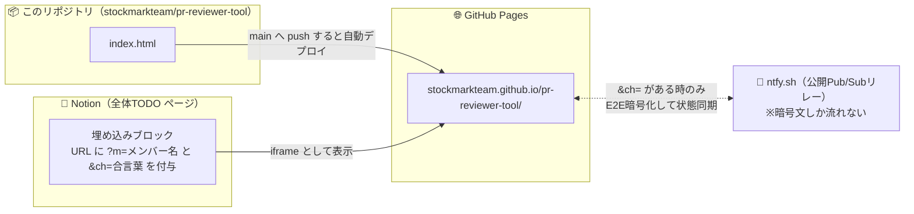

# PRレビュアールーレット

PR レビュアーを抽選で決めるツールです。**負荷（担当中のレビュー数）が少ない人ほど当たりやすい**重み付きルーレットになっています。

- 本体は [index.html](index.html) 1 ファイルのみ（ビルド不要・サーバー不要）
- GitHub Pages で配信: **https://stockmarkteam.github.io/pr-reviewer-tool/**
- チームは Notion の「全体TODO」ページに埋め込んで毎日利用しています

## 全体像



まとめ: **道具の実体がこのリポジトリ、配るのが GitHub Pages、使う入口が Notion の埋め込み**です。メンバー名簿や同期チャンネルはコードに書かず、すべて埋め込み URL のパラメータで渡します。

## 埋め込み URL の仕様

```
https://stockmarkteam.github.io/pr-reviewer-tool/?m=<名前1>,<名前2>,…&ch=<合言葉>
```

例（名前・キーはダミー）:

```
https://stockmarkteam.github.io/pr-reviewer-tool/?m=山田,佐藤,鈴木&ch=0123456789abcdef
```

### `m` — メンバー名簿（必須）

- カンマ（`,` または `、`）区切りの名前リスト。ルーレットの初期メンバーになります。
- 重複と空白は自動で除去されます。
- **恒久的なメンバーの追加・削除は、Notion の埋め込み URL のこの部分を書き換える**のが正です（画面内の「当日限りのメンバー追加」はその場限りで保存されません）。

### `ch` — 画面同期の合言葉（任意）

複数人が同じページを開いたときに、ルーレットの状態（負荷・履歴・抽選結果）を全員の画面で同期させるためのパラメータです。省略すると同期なしの単独モードで動きます。

仕組み（index.html の `initSync()` を参照）:

1. `ch` の値から SHA-256 で 2 つの値を導出する
   - `SHA-256("prr-topic:" + ch)` → ntfy.sh 上のチャンネル名（`prr-` + 先頭16バイトのhex）
   - `SHA-256("prr-key:" + ch)` → AES-GCM 256bit の暗号鍵
2. 状態はこの鍵で **端末側で暗号化してから** ntfy.sh（公開の中継サーバー）に送る
3. 同じ `ch` を知っている画面だけが復号・同期できる（中継サーバーには暗号文しか流れない）

つまり `ch` は「チャンネル名と暗号鍵の両方の元になる合言葉」です。**この値を公開の場所（このリポジトリ等）に書かないでください。** 実物は Notion の埋め込み URL の中にだけ存在させます。

#### 合言葉（暗号化キー）の作り方

任意の文字列でも動きますが、推測されないようランダムな16進文字列を推奨します:

```bash
openssl rand -hex 8        # 例: c1a2b3c4d5e6f708（現行運用と同じ16文字）
# または
openssl rand -hex 16       # より長くしたい場合（32文字）
```

キーを変えると別チャンネル扱いになるため、共有中の負荷・履歴はリセット相当になります（メンバー全員が新 URL を開き直せば揃います）。

## Notion への反映方法

1. 上記仕様の URL を組み立てる（`m` に現メンバー、`ch` に合言葉）
2. Notion の対象ページ（現在は「全体TODO」ページの Github Pull Request 節）で `/embed` ブロックを作成し、URL を貼り付ける
3. メンバー変更・キー変更のときは、**埋め込みブロックの URL を編集して差し替える**（Notion で埋め込みブロックのメニュー →「リンクを置き換える」）

## 使い方（会議での運用）

1. Notion の PR 表（PR / 作成者 / レビュアー / status）を範囲コピーして貼り付け →「読み込み」
2. 「Ready for review」かつレビュアー未記入の PR を選ぶ（作成者は自動除外）
3. 休暇の人など今回対象外の人にチェック
4. 回す → 当選者を PR 表のレビュアー欄に記入

## 開発・デプロイ

- `main` ブランチ直下がそのまま GitHub Pages で配信されます（`index.html` を編集して push すれば数分で反映）
- 外部依存なし（同期に使う ntfy.sh は任意機能で、不通でも単独モードで動作します）
